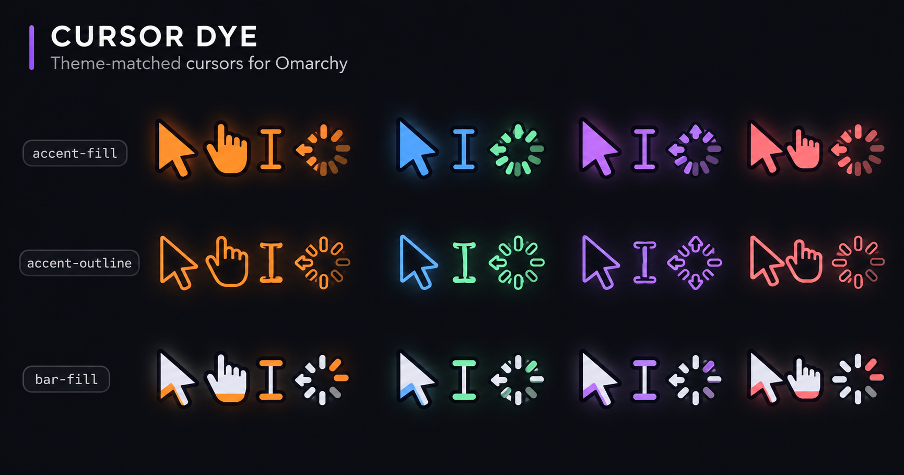
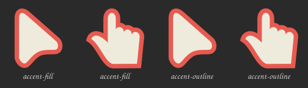

<div align="center">

# Cursor Dye

### Your cursor, finally in the theme.

Automatically tint the mouse cursor to match the active [Omarchy](https://omarchy.org) theme.

[](https://github.com/JohnAndante/omarchy-cursor-dye/actions/workflows/ci.yml)
[](https://github.com/JohnAndante/omarchy-cursor-dye/releases/latest)
[](LICENSE)

<br />



<sub>One cursor theme, rebuilt whenever your Omarchy theme changes.</sub>

<br />

[Install](#install) · [Modes](#modes) · [Presets](#presets) · [Configuration](#configuration)

</div>

## The idea

Omarchy retints your terminal, editor, browser, bar, and GTK apps when you
change themes. Your mouse cursor should not be the odd one out.

Cursor Dye reads the palette Omarchy already generated, applies it to the
[Bibata](https://github.com/ful1e5/Bibata_Cursor) cursor artwork, and keeps one
`omarchy-dye` cursor theme available in both **hyprcursor** and **XCursor**
formats. Change themes and the pointer follows automatically.

## What you get

| | |
|---|---|
| **Theme-aware** | Rebuilds from the active Omarchy palette after `omarchy theme set`. |
| **Two cursor systems** | Vector hyprcursor for Hyprland, rendered XCursor for XWayland, Electron, and games. |
| **Fast** | Builds are cached; unchanged palettes apply almost instantly. |
| **Customizable** | Choose a preset, size, silhouette, or fixed color from the Omarchy menu. |
| **Reversible** | System default mode and a clean uninstall are built in. |
| **Light-touch** | Everything stays in your home directory with one managed Hyprland block and one theme hook. |

## Install

### From the Omarchy plugin marketplace

Install **Cursor Dye** from the Omarchy plugin marketplace. The plugin service
runs `install.sh` with your user permissions and sets up the cursor automatically.

The installer may install the required native packages, fetch the pinned Bibata
SVG source, create the theme hook, and build the cursor for the current theme.
Review [`install.sh`](install.sh) if you want to inspect the setup first.

### From a checkout

Install the dependencies from the official Arch repositories, then run the
installer:

```bash
sudo pacman -S --needed hyprcursor librsvg xorg-xcursorgen xcur2png python git

git clone https://github.com/JohnAndante/omarchy-cursor-dye.git \
  ~/Projects/omarchy-cursor-dye
cd ~/Projects/omarchy-cursor-dye
./install.sh
```

The installer is safe to run again. Use `./install.sh --refresh-svg` to
re-download the pinned Bibata artwork.

### Optional: add the Omarchy menu

Menu integration is opt-in, so installation never silently edits an existing
menu extension:

```bash
~/.config/omarchy/plugins/io.github.johnandante.cursor-dye/tools/install-menu-entries.sh
```

Then open **Super + Space → Appearance → Cursor Dye**.

## Modes

Cursor Dye has three ways to behave:

| Mode | Behavior |
|---|---|
| **Follow Theme** | Rebuilds the cursor from the active Omarchy palette. This is the default. |
| **Fixed Color** | Keeps the cursor fill on a chosen hex color across theme changes. |
| **System Default** | Restores the cursor provided by your system. |

You can change modes from the menu or the command line:

```bash
omarchy-cursor-dye set mode follow
omarchy-cursor-dye set fixed-color '#39ff14'
omarchy-cursor-dye set mode default
```

## Presets

Presets decide how the active palette lands on three cursor slots: the fill,
the outline, and the spinner disc.



| Preset | Fill | Outline | Character |
|---|---|---|---|
| `accent-fill` | accent | computed neutral | Bold and unmistakably themed. |
| `accent-outline` | foreground | accent | Subtle, with a bright themed edge. |
| `accent-fill-bar` | accent | bar background | Bold, with an outline matched to the actual bar. |
| `accent-outline-bar` | bar background | accent | Subtle, with a bar-colored fill. |
| `bar-fill` | bar background | computed neutral | No accent; follows the bar. |
| `bar-outline` | computed neutral | bar background | The bar becomes the edge. |

The `bar` color comes from the active theme's real `[bar].background` value,
not from a guess.

## Sizes and silhouettes

Choose the cursor size and Bibata silhouette from the menu:

| Style | Shape | Hand |
|---|---|---|
| `modern` | rounded | right |
| `original` | sharp | right |
| `modern-right` | rounded | left / mirrored |
| `original-right` | sharp | left / mirrored |

Hyprcursor stays vector and sharp at every size. XCursor bitmaps are generated
for the sizes listed in your configuration.

## Configuration

The optional configuration file lives at:

```text
~/.config/omarchy-cursor-dye/config.toml
```

Start from [`config.example.toml`](config.example.toml):

```toml
[behavior]
mode = "follow"             # follow | fixed | default
fixed_color = "#ffffff"

[colors]
preset = "accent-fill"      # six presets are available

[cursor]
size = 24
style = "modern"            # modern | original | modern-right | original-right
```

After editing the file, apply it with:

```bash
omarchy-cursor-dye sync --force
```

The menu saves and applies its changes immediately.

### Useful commands

```bash
omarchy-cursor-dye status             # show the current mode and cursor state
omarchy-cursor-dye sync               # build if needed and apply
omarchy-cursor-dye sync --dry-run     # preview the changes
omarchy-cursor-dye build              # build without changing the session
omarchy-cursor-dye apply              # re-apply the last build
omarchy-cursor-dye clear-cache        # remove cached builds
omarchy-cursor-dye config --path      # print the configuration path
omarchy-cursor-dye env --format lua   # print the Hyprland environment block
```

One-off color overrides are also supported:

```bash
omarchy-cursor-dye sync --base '#ff5fd7' --outline '#101010'
omarchy-cursor-dye sync --base foreground
```

Already-running applications may keep the old pointer until they restart.
Hyprland and applications launched afterward update immediately.

<details>
<summary><strong>How it works</strong></summary>

When Omarchy changes themes, it stages the new palette and runs its theme hooks.
Cursor Dye then:

1. Reads the staged palette and bar colors.
2. Resolves the selected preset and computes a content hash.
3. Reuses a cached build when the colors are unchanged.
4. Otherwise dyes the Bibata SVGs and generates hyprcursor and XCursor output.
5. Installs the result as `~/.local/share/icons/omarchy-dye`.
6. Applies it to Hyprland and the desktop cursor settings.

The theme name never changes; only its generated contents do. This keeps the
Hyprland environment integration stable across theme changes.

</details>

## Uninstall

From the checkout, run:

```bash
./uninstall.sh                 # add --keep-config to keep config.toml
```

This removes the command, hook, generated theme, cache, and managed Hyprland
block, then restores the system cursor. Log out or restart Hyprland to fully
clear the cursor environment.

## Development

CI runs ShellCheck, Python syntax checks, TOML validation, and an end-to-end
build in an Arch container. The end-to-end checks cover every preset and
silhouette, invalid configuration, generated cursor output, and uninstall.

See [`CHANGELOG.md`](CHANGELOG.md) for release history and [`SECURITY.md`](SECURITY.md)
for security reports.

## Credits and licenses

Cursor artwork comes from [Bibata](https://github.com/ful1e5/Bibata_Cursor) by
Abdulkaiz Khatri and is licensed under GPL-3.0. Generated cursor themes are
derivative works of Bibata. Cursor Dye itself is MIT-licensed.

See [`NOTICE.md`](NOTICE.md) for the license split.
